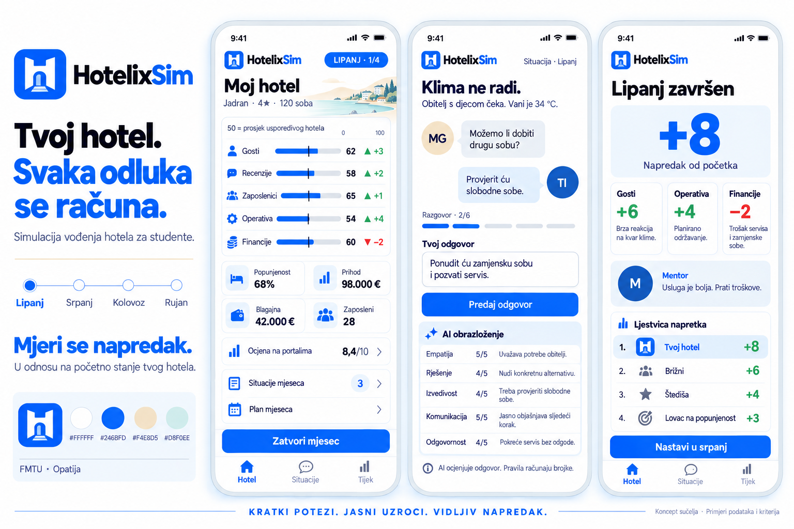

# HotelixSim — dizajn sučelja (Leonov koncept, v2)

> Što ekran mora pokazati i kako izgleda. Izvor: Leonov logo i koncept ekrana u [dizajn/](./dizajn/) (v2 od 10.10.;
> prvi koncept od 09.10. zamijenjen je, ostaje u gitu). Odluke: [ADR-020](../records/DECISIONS/ADR-020-sucelje-tailwind-i-leonov-koncept-dizajna.md) (Tailwind),
> [ADR-021](../records/DECISIONS/ADR-021-koncept-ekrana-v2-i-odluke-o.md) (koncept v2 i Leonove odluke), pretpostavke ekrana
> [ADR-022](../records/DECISIONS/ADR-022-ekrani-igraca-pretpostavke-plana-koraka-5.md). Što igra radi: [DEMO.md](./DEMO.md).

## 1 · Marka

- **Ime:** uvijek „HotelixSim"; u logu „Hotelix" tamno, „Sim" plavo ([ADR-002](../records/DECISIONS/ADR-002-ime-hotelixsim-nikad-skraceno-na-hotelix.md)).
- **Znak:** plavi zaobljeni kvadrat s bijelim „H" koje je ujedno ulaz u hotel (svijetloplava vrata i stube).
- **Boje (v2):** bijela `#FFFFFF` · primarna plava `#246BFD` · pijesak `#F4E8D5` · menta `#D8F0EE`; tamna za tekst i
  naslove (`#151B2B` iz v1). Uz to: zelena za napredak (▲ +), crvena za pad (▼ −), svijetloplava pozadina kartica.
- **Slogan:** „Kratki potezi. Jasni uzroci. Vidljiv napredak." · uvodni naslov „Tvoj hotel. Svaka odluka se računa."
  · „Mjeri se napredak. U odnosu na početno stanje tvog hotela."
- **Stil:** svijetlo, čisto, zaobljene kartice, debeli bezserifni naslovi, ikone uz svaki podatak, mobitel prvi.
  **Likovi** (gost, kuhar, mentor, ti) crtaju se iz SVG slojeva (koža, kosa, oči, usta, brada, naočale, kapa, odjeća);
  izgled je podatak (`AvatarLook`, `apps/web/src/avatar/`), pa ga poslije demoa uređivač mijenja kao u BitLifeu
  ([ADR-021](../records/DECISIONS/ADR-021-koncept-ekrana-v2-i-odluke-o.md)). Galerija svih slojeva: `/likovi`.
- **U kodu:** boje, slova i zaobljenja žive **samo** u `@theme` tokenima (`apps/web/src/styles.css`); ekrani koriste
  imena tokena (`bg-accent`, `text-ink`…), nikad heks. Novi izgled = nove vrijednosti tokena.

## 2 · Ekrani iz koncepta

| ekran | što pokazuje | odakle podaci (API) |
|---|---|---|
| **Moj hotel** | oznaka mjeseca („LIPANJ · 1/2"), broj soba, pet indeksa s trakama 0–100 i oznakom „50 = prosjek usporedivog hotela", uz svaki promjena od početka (▲ +3 / ▼ −2), kartice popunjenost · prihod · blagajna · zaposleni, ocjena na portalima „8,4/10", „Situacije mjeseca" s brojem neodgovorenih, „Plan mjeseca", gumb „Zatvori mjesec", donja traka Hotel · Situacije · Tijek | `GET /v1/me/hotel`, `/v1/games/{id}`, `…/situations` |
| **Situacija** | naslov i opis, razgovor s likom kao chat s crtanim likovima, „Razgovor · 2/6", polje „Tvoj odgovor", „Predaj odgovor", „AI obrazloženje" po kriterijima, napomena „AI ocjenjuje odgovor. Pravila računaju brojke." | `…/situations`, `…/conversation`, `…/messages`, `…/response`, `…/answer` |
| **Mjesec završen** | veliki napredak od početka („+8"), promjene indeksa, uzroci promjena, mentor (crtani lik), ljestvica napretka (Tvoj hotel i tri robota), „Nastavi u srpanj" | `/v1/games/{id}` (`hotels[].months`), `/v1/me/hotel` (`last_month.mentor`), feed (`change`) |

Donja traka „Tijek" = feed hotela (vremenska crta). Profesorov pogled nije u konceptu (DEMO korak 6).

## 3 · Koncept i igra — kako je riješeno (10.10.)

1. **AI obrazloženje:** igra za svaki kriterij kaže **ispunjen / nije** uz rečenicu razloga, a ukupno je broj ispunjenih
   ([ADR-019](../records/DECISIONS/ADR-019-ai-sloj-arhitektonske-pretpostavke-koraka-4.md) t. 2). Ekran: redak po kriteriju s ✓/✗, **cijelom rečenicom kriterija** i
   AI-jevim razlogom, a ukupno „4/5" (Leon, anketa 10.10.). Kratkih naziva („Empatija") nema.
2. **Ocjena na portalima:** „8,4/10", bez preračuna (Leon, anketa 10.10.).
3. **Broj mjeseci:** demo ima dva (lipanj, srpanj) → oznaka „LIPANJ · 1/2" (Leon, anketa 10.10.).
4. **Uzroci promjena:** „Zašto se indeksi pomaknuli" na „Mjesec završen" prikazuje gotove ljudske retke s poslužitelja
   (`GET /v1/hotels/{hotel_id}/months/{month}/explanation`, iste činjenice kao mentor); web ne prevodi kodove uzroka.
5. **Avatari:** crtani likovi iz slojeva umjesto inicijala iz koncepta v2 (Leon, anketa 10.10.); uređivač poslije demoa.
6. **„Nastavi u srpanj":** u igri srpanj otvara obračun lipnja; gumb samo vodi na „Moj hotel" za srpanj.
7. **Ilustracija obale** u zaglavlju „Moj hotel" i „Jadran · 4★" nemaju izvor (nema slike ni regije u API-ju) — dok ne
   stigne slika, zaglavlje je bez nje ([ADR-022](../records/DECISIONS/ADR-022-ekrani-igraca-pretpostavke-plana-koraka-5.md)).
